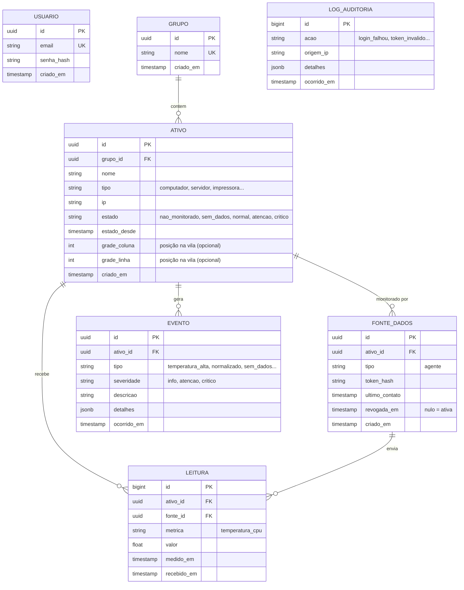

# Modelo de dados (MVP)

Primeira versão, pensada para o MVP. Vai mudar com a implementação; quando mudar,
este arquivo muda junto.

## Notas de projeto

- **`ATIVO.estado` é derivado, mas guardado.** A fonte da verdade são os eventos; o campo
  guardado existe para a lista carregar rápido. Toda mudança de estado nasce de um evento (RN03).
- **`grade_coluna` e `grade_linha` são só posição lógica na grade.** Nunca coordenadas 3D.
  A API não sabe que existe uma vila; uma tabela ou um mapa 2D usam o mesmo dado.
- **`LEITURA.metrica` é texto**, para que novas métricas (uso de memória, eventos de login)
  entrem sem mudar a tabela.
- **`medido_em` e `recebido_em` separados**: o relógio do agente pode estar errado, e a
  diferença entre os dois também é um sinal.
- **`FONTE_DADOS` separada de `ATIVO`** materializa a distinção entre descobrir e monitorar (ADR 0002).
- Ainda não modelado (depois da v1): aparelhos descobertos na rede (cidadãos e encapuzados),
  usuários com papéis diferentes, limites por ativo.
